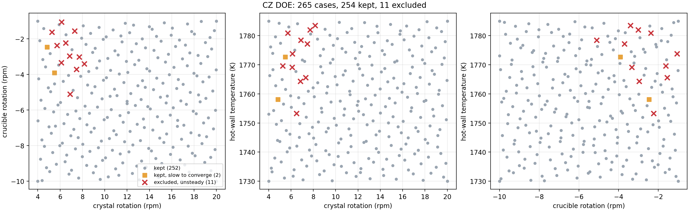

# CZ-Dataset-Doe

CFD reference data for the silicon melt in a Czochralski (CZ) crystal puller, run in ANSYS Fluent
over 265 combinations of crystal rotation, crucible rotation and hot-wall temperature.

The data is made for people building fast prediction models (surrogates, physics-informed neural
networks, graph networks) who need trustworthy CFD results to train and test against. Every case
uses the same mesh, the same model and the same convergence target, and every case that did not
behave is listed with the reason.

This is the second dataset of the project. The first one (three one-parameter sweeps, 33 cases,
converged to Fluent's default 1e-3) is published separately and is not changed by this repository.

## Changes from version 1

This dataset is version 2 of the CZ melt-flow dataset. Version 1 (three one-parameter sweeps,
33 cases) stays published unchanged and is still available as the previous version.

| | Version 1 | Version 2 (this dataset) |
|---|---|---|
| Design | three one-parameter sweeps through one anchor point | 256 Sobol points over the whole parameter box, plus 8 corners and the centre |
| Cases | 33 | 265 run, 254 kept; plus 60 coarse/fine mesh cases and 43 hold-out cases |
| Parameter ranges | crystal 4 to 20 rpm, crucible −1 to −10 rpm, hot wall 1730 to 1785 K | the same |
| Convergence | stopped at Fluent's default 1e-3 | all five residuals to 1e-6, heat balance checked |
| Base case | 1745 K anchor | 1750 K case reproducing Huang et al. (2025) |
| Rotation values | typed in by hand (0.838 / −0.314 rad/s, 0.03 % / 0.05 % off 8 / −3 rpm) | exact, through named expressions |
| Model and mesh | 2D axisymmetric, laminar, 8,181 nodes | the same model, schemes, materials, boundary conditions and mesh |
| Unsteady cases | 1790 to 1800 K kept separately as transient | excluded and listed with the reason |
| Checks | certification per case | certification per case, mesh study (GCI), hold-out tests |

**What this means for version 1 data.** Rerun at 1e-6 with the same settings, the version 1 cases
differ by typically 1 to 5 % in the velocity fields (up to about 11 % for a few crucible cases),
because version 1 stopped at 1e-3. The version 1 temperature cases at 1765, 1770, 1775, 1780 and
1785 K are not steady solutions: at 1e-6 they keep oscillating, also when started from the
converged 1760 K solution. They met the 1e-3 target after about 1,000 iterations, before the
oscillation set in, so they looked converged. Converged versions of all other version 1 cases are
part of the hold-out set here.

The data format is unchanged: one table per case with r, z, u_r, u_z, u_swirl, p and T at every node.

## The physical problem

In the Czochralski process a single silicon crystal is pulled slowly out of a crucible of molten
silicon. The crystal and the crucible rotate in opposite directions, and the crucible wall is hotter
than the crystal. Rotation and buoyancy together drive the flow in the melt, and that flow controls
how heat reaches the growing crystal.

I model a vertical half-slice of the melt (from the centre axis to the crucible wall) and let
Fluent treat it as rotationally symmetric. That keeps every case small enough to run on a student
licence while still capturing swirl and buoyancy.

| Item | Value |
|---|---|
| Model | 2D axisymmetric with swirl, steady, laminar |
| Geometry | crucible radius 0.30 m, crystal radius 0.18 m, melt height 0.15 m |
| Mesh | 8181 nodes (8000 cells), identical for every case |
| Crystal face | rotates with the crystal, 1685 K |
| Crucible wall | rotates with the crucible, at the hot-wall temperature T_hot |
| Crucible bottom | rotates with the crucible, temperature linear from 1700 K at the axis to T_hot at the wall |
| Melt surface outside the crystal | no-slip lid with a prescribed swirl that ramps linearly from the crystal edge to the wall, no up/down or in/out flow; temperature linear from 1685 K to T_hot |
| Buoyancy | Boussinesq, β = 1.5e-4 1/K, reference temperature 1717 K, g = 9.81 m/s² downwards |
| Pressure | reported without the hydrostatic part |
| Convergence | all five residuals (continuity, two velocities, swirl, energy) below 1e-6 |

The setup follows Huang et al., *AIP Advances* 15(10), 105202 (2025),
doi:[10.1063/5.0271778](https://doi.org/10.1063/5.0271778).

## What was run

Instead of changing one parameter at a time, all three are changed together, spread evenly over
the whole operating box with a Sobol design (a way of placing points so no region is left empty).
The corners and the centre of the box are added on top.

| Parameter | Range |
|---|---|
| crystal rotation | 4 to 20 rpm |
| crucible rotation | −10 to −1 rpm (negative = opposite to the crystal) |
| hot-wall temperature | 1730 to 1785 K |

| Group | Cases | Why |
|---|---|---|
| `sobol` | 256 | evenly spread over the box (seed 42) |
| `corner` | 8 | the extremes of the box |
| `centre` | 1 | the middle of the box |

`case_matrix.csv` holds the exact values of every case and is the single reference for them.

**Hold-out cases.** `holdout_cases.csv` lists 43 extra cases that are never used for training:

- **31 sweep cases:** the three one-parameter sweeps of the first dataset, at exactly the same values
  and anchor (8 rpm, −3 rpm, 1745 K), now converged to 1e-6. They test models along familiar lines
  and show whether stopping the first dataset at 1e-3 changed any result.
- **12 cases outside the box:** for each parameter two values just past the limit and one far
  value: crystal 22, 24 and 30 rpm; crucible −11, −12 and −0.5 rpm; hot wall 1790, 1795 and
  1810 K; and three cases with all three outside at once. Industrial pullers use roughly 5 to 30 rpm
  for the crystal and 0.5 to 10 rpm for the crucible, so 30 rpm and −0.5 rpm are realistic settings.
  The 1810 K wall is my choice, not taken from a source. The parameters not being varied sit at
  the centre of the box. At 30 rpm a real melt would be strongly turbulent, so these cases test
  the laminar model, not a real furnace.

**Hold-out results.** 38 of the 43 hold-out cases reached a steady solution and pass certification:
all 12 cases outside the box, all crystal and crucible sweep cases, and the temperature sweep up to
1760 K. The temperature cases at 1765, 1770, 1775, 1780 and 1785 K (at 8 rpm and −3 rpm) do not
settle: the continuity residual stays around 1e-2 for 30,000 iterations and the heat balance is off
by 2 to 8 %, the same signature as the 11 excluded DOE cases. Starting from the converged 1760 K
solution instead of a fresh start gives the same result, so at these settings the flow stops being
steady between 1760 and 1765 K.

Compared with the first dataset, which stopped at 1e-3, the converged sweep cases differ by
typically 1 to 5 % in the velocity fields (up to about 11 % for a few crucible cases). The first
dataset's temperature cases at 1765 to 1785 K met the 1e-3 target after about 1,000 iterations,
before the oscillation set in, so they looked converged without being steady.

The per-case results are in `holdout/run_status.csv` and `holdout/excluded_cases.csv`, written by:

```
python -m cz_doe.status results_holdout --case-matrix holdout_cases.csv --out holdout
```

## Results so far

Of the 265 runs, **254 reached a steady solution and are kept**. **11 are excluded.**



The 11 excluded cases ran the full 30,000 iterations without converging. Their continuity residual
stopped falling at about 1e-2 and kept swinging up and down, and their heat balance (heat in vs heat
out of the melt) was off by 0.6 to 7 %. For comparison, the kept cases converged in about 3,500
iterations on average and their heat balance closes within 0.02 %. In other words, these cases are
not slow, the flow there does not settle to a steady state at all. A steady model cannot describe
them, so they are left out of the dataset rather than included with a misleading field.

They are not scattered randomly. All 11 sit in one region: crystal rotation of roughly 5 to 8 rpm,
weak crucible rotation (−1 to −5 rpm) and a hot wall above about 1753 K. This is the same crystal
rotation range where the first dataset showed the main flow loop reversing direction, which is a
likely explanation, but I have not proven it with transient runs.

Two kept cases, `sobol_068` and `sobol_084`, needed 13,000 and 24,000 iterations. They pass every
check but lie at the edge of that region, so they are marked `slow` in `run_status.csv`.

Files with the details:

- `run_status.csv`: every case with its parameters, kept or excluded, iterations, final residuals,
  heat-balance error and the plateau ratio (see below).
- `excluded_cases.csv`: only the 11 excluded cases.

The **plateau ratio** compares the typical continuity residual of the last 5,000 iterations with the
5,000 before. A case that is still converging gives a small number (the two slow cases give about
0.05). A case that has stopped improving gives about 1. All 11 excluded cases are between 0.98 and
1.02.

## Mesh study: coarse and fine meshes

To show how much the results depend on the mesh, and to give multi-fidelity models cheaper and
more accurate versions of the same cases, 30 cases are also run on a coarser and a finer mesh.

| Mesh | Edge divisions | Nodes | Status |
|---|---|---|---|
| coarse | 50 × 40, half of the base | 2,091 | 30 cases run and certified |
| base | 100 × 80 | 8,181 | the main dataset above |
| fine | 199 × 160, about double the base | 32,200 | 30 cases run and certified |

The 30 cases are the first 32 Sobol points (`sobol_000` to `sobol_031`) without `sobol_012` and
`sobol_028`, which lie in the unsteady region. The first 32 points of a Sobol design are already
spread evenly over the box, so this subset is not hand-picked. Every mesh keeps the same bias
towards the walls, and every case uses the same Fluent settings as the base case (copied with
`/file/write-settings` and `/file/read-settings`), so the mesh is the only thing that changes.

All 60 extra runs converged to 1e-6 (coarse 2,300 to 5,900 iterations, fine 1,800 to 6,300) and
close the heat balance within 0.02 %.

**How much do the results depend on the mesh?** For each of the 30 cases I compared a few key
numbers on the three meshes and used the grid convergence index (GCI, the standard method of
Celik et al., 2008). The GCI estimates how far the base-mesh result could still be from a
mesh-independent answer. Next to it is the plain change when going from the base to the fine mesh.

| Quantity | GCI of base mesh, median (max) | Change base → fine, median (max) |
|---|---|---|
| strongest upward/downward velocity | 0.50 % (5.3 %) | 0.33 % (0.75 %) |
| velocity on the axis at mid-depth | 0.41 % (2.1 %) | 0.27 % (1.4 %) |
| pressure difference across the melt | 0.28 % (0.56 %) | 0.15 % (0.36 %) |
| strongest radial velocity | 0.29 % (0.97 %) | 0.18 % (0.33 %) |
| swirl at r = 0.24 m, mid-depth | 0.02 % (1.3 %) | 0.01 % (0.70 %) |
| temperature at r = 0.15 m, mid-depth | 0.008 % (0.04 %) | 0.08 K (0.49 K) |

Over the whole field, the fine mesh differs from the base mesh by 0.1 to 0.2 % (at most 0.7 %),
the coarse mesh by 1 to 2 % (at most 6.6 %). So the 8,181-node base mesh is fine enough for this
model: refining it further changes the results by well under 1 % in almost every case.

Things to know when using these numbers:

- The larger values all come from the strongest rotation (crystal 15 to 20 rpm, crucible −6 to
  −10 rpm). Faster flow forms thinner layers, which need smaller cells.
- The GCI can overstate a single case. For `sobol_007` it gives 5.3 % for the strongest vertical
  velocity, while the real change from base to fine is 0.5 %. That is why both columns are shown.
- In a few cases a quantity does not change steadily from coarse to base to fine (it moves up and
  then slightly down). These changes are very small, but the GCI formula does not apply there.
- Temperature hardly depends on the mesh: the median change is under 0.1 K.

Every number above comes from `mesh_study_quantities.csv` (key quantities per case and mesh, with
the GCI) and `mesh_study_fields.csv` (whole-field differences), both written by:

```
python -m cz_doe.mesh_study --coarse data_mf_coarse --base data_doe --fine data_mf_fine
```

**Converting the other meshes.** `convert` puts every case's nodes into the same order as a
reference table, and each mesh needs its own reference: the anchor case (8 rpm, −3 rpm, 1750 K)
run on that mesh and exported from Fluent, turned into a table sorted by height and then radius.
A hand export from the Fluent window can list one node twice with identical values, so exact
duplicates are dropped. For the coarse mesh:

```
python -c "from cz_doe.fluent_io import read_export; read_export('anchor_coarse_raw.txt').drop_duplicates().sort_values(['z', 'r']).to_csv('cz_1750_coarse_2091.csv', index=False)"
python -m cz_doe.convert --reference cz_1750_coarse_2091.csv --out data_mf_coarse results_mf_coarse
python -m cz_doe.certify --nodes 2091 --axis-tol 0.02 data_mf_coarse
```

The fine mesh works the same way with `anchor_fine_raw.txt`, `cz_1750_fine_32200.csv`,
`--nodes 32200` and the default axis limit.

**One check is mesh dependent.** On the symmetry axis the radial and swirl velocities must be zero.
Fluent computes node values on the axis by averaging the neighbouring cells, so a small leftover
remains, and it grows with cell size. The check is there to catch export mistakes, such as swapped
velocity columns, which would show up as about 100 %. Its limit is therefore tied to the cell size:
1 % of the field maximum on the base and fine meshes, and 2 % on the coarse mesh, whose cells are
twice as large. All cases pass. The leftover halves with each refinement (median 0.36 % coarse,
0.15 % base, 0.08 % fine), which is itself a sign that the solution converges with the mesh.

## What is in this repository

```
case_matrix.csv        the 265 cases and their parameter values
holdout_cases.csv      43 extra test cases, never used for training
holdout/               outcome of the 43 hold-out runs
mesh_study_*.csv       mesh study results: key quantities, GCI, whole-field differences
run_status.csv         outcome of every run
excluded_cases.csv     the 11 runs that did not reach a steady solution
figures/               plots
cz_doe/                the Python code (described below)
tests/                 automatic checks for the code
```

What is deliberately **not** in this repository:

- The Fluent case and data files (`.cas.h5`, `.dat.h5`). They are large and need Fluent to open.
- The Fluent transcripts (`.trn`). They contain details of my computer and folder paths, and every
  number that matters from them is already in `run_status.csv`.
- The generated journal files. They contain the absolute folder paths of my computer and are
  rebuilt with one command.

The converted CFD fields (one table per case with r, z, u_r, u_z, u_swirl, p and T at every node)
will be published on Zenodo with their own DOI once all cases are certified.

## How the work flows

Each step is one command. The code only automates what I would otherwise click through in Fluent
265 times, and it checks the results instead of trusting them.

```
python -m cz_doe.case_matrix                       # 1. list the cases (already done: case_matrix.csv)
python -m cz_doe.journals --base-case <case.cas.h5> --results <results folder>
                                                # 2. write one Fluent journal per case
# in Fluent (2D, double precision): File > Read > Journal > journals/run_all.jou
                                                # 3. Fluent runs every case and exports the results
python -m cz_doe.check_runs <results folder>    # 4. quick check: converged? heat balance closed?
python -m cz_doe.status <results folder>        # 5. sort cases into kept / excluded, make the plot
python -m cz_doe.convert --reference <reference.csv> --out data <results folder>
                                                # 6. turn Fluent exports into clean tables
python -m cz_doe.certify data                   # 7. check every boundary condition in every table
                                                #    other meshes: add --nodes 2091 --axis-tol 0.02
```

What each part of `cz_doe/` does:

| File | Job |
|---|---|
| `case_matrix.py` | builds the case list (Sobol points, corners, centre) |
| `holdout_cases.py` | builds the 43 hold-out cases (v1 sweeps, cases outside the box) |
| `mesh_study.py` | compares the three meshes case by case and computes the GCI |
| `journals.py` | writes the Fluent journal for each case; only the three parameters change |
| `boundary_conditions.py` | the boundary conditions written as formulas, so they can be checked |
| `fluent_io.py` | reads Fluent exports, transcripts and heat-flux reports by column name, never by position |
| `check_runs.py` | flags runs that did not converge or do not close the heat balance |
| `status.py` | writes `run_status.csv`, `excluded_cases.csv` and the parameter-space plot |
| `convert.py` | matches nodes by their coordinates, because Fluent numbers nodes differently between exports |
| `certify.py` | recomputes every boundary condition from the case parameters and compares with the exported field |

The base case must define three named expressions, `omega_cry` and `omega_cru` (in 1/s) and
`T_hot`, with every boundary condition written in terms of them. The journals only change these
three values.

## Limits

These are controlled reference solutions for developing and testing prediction methods, not a model
of a real industrial puller. The flow is assumed laminar, axisymmetric and steady, with a flat melt
surface, no Marangoni (surface tension) flow, no radiation and no magnetic field. At the higher
rotation rates the rotational Reynolds number is at or above the range where real CZ melts become
turbulent, so the results there describe the laminar model, not the real furnace.

## Still to do

- Publish the 254 kept cases on Zenodo. They are converted and all 254 pass certification.
- Publish the coarse and fine mesh sets on Zenodo together with the main data.
- One HDF5 file per case including the mesh connectivity, for graph-based models.
- Publish the 38 certified hold-out cases on Zenodo with the main data.

## Running the code yourself

You need Python 3.10 or newer.

```
pip install -e .[dev]
pytest                       # runs the automatic checks
ruff format . && ruff check .  # keeps the code tidy
```

Steps 2 and 3 above need ANSYS Fluent. Everything else runs without it.

## How to cite

See `CITATION.cff`, or use the "Cite this repository" button on GitHub. A DOI for the data will be
added here once it is on Zenodo.

## Licence

- Code: MIT, see [LICENSE](LICENSE).
- Data (case list, run summaries, figures and the converted fields): CC BY 4.0, see
  [LICENSE-DATA](LICENSE-DATA). Use it freely, including commercially, as long as you credit it.

